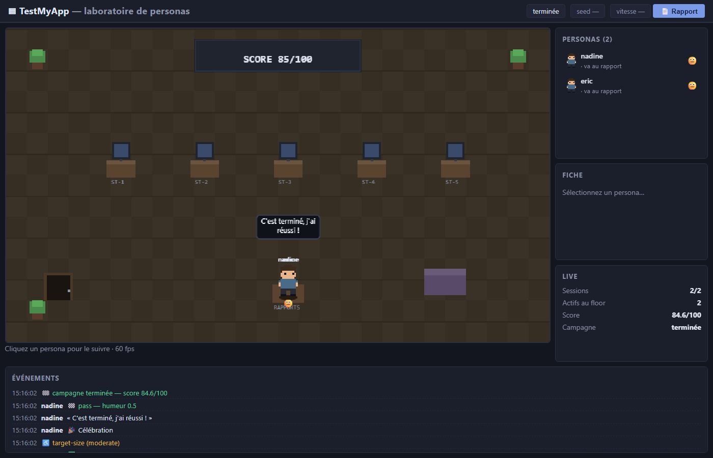

# TestMyApp

[](https://github.com/azerothl/testMyApp/actions/workflows/web-browsers.yml?query=branch%3Amain+event%3Apush)
[](https://github.com/azerothl/testMyApp/actions/workflows/web-firefox.yml?query=branch%3Amain+event%3Apush)
[](https://github.com/azerothl/testMyApp/actions/workflows/web-webkit.yml?query=branch%3Amain+event%3Apush)
[](https://github.com/azerothl/testMyApp/actions/workflows/windows-desktop.yml?query=branch%3Amain+event%3Apush)

TestMyApp fait jouer des parcours à des personas simulés sur une application, les représente dans un laboratoire pixel art et produit un rapport relié aux étapes, mesures et captures du run. La référence produit est [SPEC.md](SPEC.md), révision 1.0.2. Les recettes couvrent Chromium, Firefox, WebKit et Windows.



## Installation

Sous Windows x64, téléchargez l’exécutable portable depuis les [releases GitHub](https://github.com/azerothl/testMyApp/releases). Ouvrez le fichier pour lancer l’accueil sans installer Python. Pour les campagnes Web et l’export PDF, installez Chromium une fois depuis PowerShell, dans le dossier de téléchargement.

```powershell
.\TestMyApp-v0.2.2-windows-x64.exe install-browser chromium
```

L’exécutable retrouve automatiquement le navigateur installé lors des lancements suivants.

```bash
# Python 3.11+
pip install -e .
pip install -e ".[web]"
python -m playwright install chromium
testmyapp selftest
```

## Première campagne

```bash
testmyapp init
testmyapp run --mode headless
testmyapp report "runs/<id>" --open
```

La démo simulée contient des défauts volontaires. Le rapport est produit même si le verdict bloque la campagne.

| Code | Résultat |
|---|---|
| 0 | Campagne réussie |
| 1 | Erreur d’exécution, campagne interrompue ou aucune mesure fonctionnelle |
| 2 | Échec d’une étape critique, abandon ou score sous le seuil |

Une étape est critique par défaut. Ajoutez `critical = false` à une étape explicitement informative. Les axes sans mesure sont affichés comme « non mesuré » et exclus de la moyenne pondérée. Un score favorable ne neutralise pas un verdict critique.

## Rapports, reprise et interfaces

- `testmyapp gui` ouvre l’accueil **Projets et rapports**. Ajoutez le dossier TestMyApp de chaque projet, celui qui contient ses campagnes ou ses anciens résultats. L’accueil mémorise les dossiers et affiche l’historique du projet sélectionné. Avant de lancer une campagne, vous pouvez modifier la liste des personas précochés pour ce test. **Lire le rapport** ouvre le résultat conservé, **Rejouer** montre les événements enregistrés dans le Test Floor et **Reprendre la campagne** continue les tests interrompus. Vous pouvez aussi enregistrer un dossier au démarrage avec `testmyapp gui --dir "D:/dev/mon-projet" --name "Mon projet"`.
- Le dossier `runs/<id>` contient `campaign.json`, le journal `events.jsonl`, les métriques, les captures et les rapports Markdown, HTML et JSON. Le [schéma JSON v2](testmyapp/assets/schemas/report-v2.json) est vérifié lors de la génération. L’HTML contient les preuves et les images intégrées pour une consultation hors ligne.
- `testmyapp report "runs/<id>" --format pdf --open` exporte `report/report.pdf` depuis le HTML du run. L’export A4 conserve les captures, les liens internes et les détails de preuve. Il utilise Chromium via Playwright, quel que soit le navigateur qui a exécuté le test. Installez l’option `[web]` et Chromium pour exporter.
- `testmyapp run --resume "runs/<id>"` rouvre le même dossier. Le moteur vérifie la configuration, réutilise les sessions terminées et joue celles qui restent. Une dernière ligne de journal incomplète est conservée dans un fichier `.partial`. Les nouveaux runs vérifient aussi le contenu des personas et des scénarios. Pour les anciens manifestes dépourvus d’empreinte, seuls les champs conservés dans le manifeste initial peuvent être comparés.
- `testmyapp run --mode gui` ouvre le Test Floor local sur le port 7417. Chaque station mène aux verdicts et aux captures de sa session. Les commandes Pause et Arrêter s’appliquent à la file ; les sessions déjà actives se terminent. L’interface reste accessible jusqu’à l’arrêt du serveur.
- `testmyapp run --mode tui` affiche le tableau de bord du terminal. Entrée ouvre une session, **P** met la file en pause ou la relance, **S** l’arrête et **O** ouvre le rapport.
- `testmyapp replay "runs/<id>"` rejoue les événements. `testmyapp compare "runs/A" "runs/B"` compare les scores et les constats.

Dans l’accueil, **Voir le profil** présente les objectifs et les réactions habituelles de chaque persona. Sur le Web, le profil clavier cherche les contrôles avec Tab et les active au clavier. Le profil tactile appuie sur les contrôles à l’écran. Pour un parcours scripté, une étape peut définir `[steps.action_paths]` avec une liste d’actions pour `"input:keyboard"`, `"input:mouse"`, `"input:touch"` ou `"persona:<id>"`. La variante du persona est prioritaire, suivie de celle de son mode d’interaction puis des actions communes. Les attentes de l’étape s’appliquent à tous les parcours. La boutique de démonstration utilise ces variantes pour soumettre la recherche de trois façons.

Pour proposer des tâches de découverte dans l’accueil, ajoutez `[discovery]` au TOML de campagne et associez les identifiants de personas à des identifiants de scénario. La liste de tâches inclut ces scénarios et ceux de `matrix.scenarios`. À l’écran, chaque persona joue la tâche choisie pour lui. Un scénario qui déclare `task_text` rend son message modifiable et l’utilise dans les actions de saisie dont le texte vaut `{task.text}`. Les attentes restent définies dans le scénario. Le choix et le message sont conservés avec le run pour sa reprise.

Pour une cible Web ou une cible Windows compatible, choisissez **Créer une tâche libre** et entrez un objectif ainsi qu’un résultat observable. Pour une demande de conversation, indiquez le message souhaité entre guillemets, par exemple « Demander “Aide” ». Comme résultat, indiquez un extrait de la réponse attendue ou un état d’option tel que « Résumé détaillé coché ». Le persona choisit parmi les contrôles visibles à chaque action et s’arrête lorsque le résultat apparaît ou que son budget de dix décisions est épuisé. Windows utilise le relevé des contrôles Tk de l’instance de test avec `discovery_bridge = true`. Le Web utilise les contrôles visibles de la page et accepte, si nécessaire, un fichier Playwright `storage_state` avec une session de recette. Ce fichier peut contenir des cookies d’authentification. Le rapport indique les interactions tentées et le critère effectivement observé.

## Recettes de référence

### Chromium, Firefox et WebKit

Après `testmyapp init`, lancez les deux variantes dans des terminaux distincts.

```bash
testmyapp demo --port 7418
testmyapp demo --fixed --port 7419
```

```bash
testmyapp run -c recette-web --mode headless
testmyapp run -c recette-web-corrigee --mode headless
```

La première variante contient un chargement de paiement lent, une image sans alternative, une case sans libellé et un contraste faible. Les deux campagnes jouent le même scénario avec Éric et Karim, dont les interactions passent par le clavier. Le driver enregistre les timings de navigation, des mesures laboratoire LCP/CLS/INP quand le navigateur expose les observations nécessaires, les réponses réseau et les résultats d’axe-core embarqué. Les signalements automatiques et les contrôles humains sont identifiables dans le rapport.

Pour jouer la recette sur un autre moteur, installez-le avec `python -m playwright install firefox webkit` et réglez `browser = "firefox"` ou `browser = "webkit"` dans le TOML de la cible. Sur Windows, les trois moteurs ont joué le parcours jusqu’au paiement avec captures, traces, LCP et signalements axe-core. Le CLS était indisponible dans les versions de Firefox et WebKit testées. Les profils de limitation réseau et CPU s’appliquent à Chromium via CDP. La boutique de référence rend ses liens explicitement accessibles par Tab sur WebKit.

Les URL persistées perdent leurs paramètres et identifiants. Les traces Playwright et vidéos sont désactivées par défaut et peuvent contenir le DOM, les formulaires et le trafic bruts. Les campagnes de référence les utilisent sur des données fictives.

### Windows

Dans une session Windows interactive, lancez la recette avec l’exécutable portable.

~~~powershell
.\TestMyApp-v0.2.2-windows-x64.exe init
.\TestMyApp-v0.2.2-windows-x64.exe target check demo-windows
.\TestMyApp-v0.2.2-windows-x64.exe run -c recette-windows --mode headless
~~~

Si vous avez installé TestMyApp avec Python, les mêmes commandes sont disponibles via le terminal.

```bash
pip install -e ".[desktop]"
testmyapp target check demo-windows
testmyapp run -c recette-windows --mode headless
```

La recette ouvre une application WinForms locale et joue trois scénarios indépendants. Elle vérifie une action UI Automation et la reprise après un gel, puis provoque une fermeture inattendue de la cible. Le code de sortie attendu est **1** pour cette campagne de test du pilote.

Le code source de la démo et la commande de reconstruction sont disponibles dans le dépôt. [Recompiler la démo WinForms](packaging/windows/build-demo.ps1)

Dans `targets/ma-cible.toml`, déclarez le modèle d’un contrôle dessiné. Le chemin est relatif au fichier TOML. La région facultative indique `[x, y, largeur, hauteur]` en pixels physiques de la zone cliente. Préparez le modèle à l’échelle d’affichage du test.

```toml
[templates."Confirmer"]
path = "images/confirmer.png"
confidence = 0.95
region = [233, 120, 250, 115]
```

Une action `{ type = "click", name = "Confirmer" }` essaie UI Automation puis le modèle du même nom. Utilisez `template` pour désigner un autre modèle. Le repli couvre clic, invocation, saisie et attente de visibilité. La fenêtre doit rester au premier plan. Un modèle absent, ambigu ou masqué produit un échec. Le journal et le rapport enregistrent la méthode, le rectangle détecté et la confiance.

## Comportement des personas

Les huit profils TOML embarqués sont éditables. `testmyapp persona generate --archetype nadine --count 5 --seed 42` crée des variantes reproductibles. En mode `scripted`, le profil module les actions et réessais. En mode `explore`, il choisit parmi les boutons et liens observés et joue chaque choix au fil de l’exploration. Il s’arrête quand l’objectif est atteint ou que le budget de l’étape est épuisé.

Le mode `agent` est facultatif. Il se configure à la fois sur l’étape et dans la campagne. L’exemple utilise l’[interface de compatibilité d’Ollama](https://docs.ollama.com/api/openai-compatibility).

```toml
[ai]
enabled = true
endpoint = "http://127.0.0.1:11434/v1/chat/completions"
model = "nom-du-modele-local"
max_requests = 4
timeout_seconds = 3
```

Le fournisseur reçoit le but, le rôle et le libellé des choix possibles. Les valeurs écrites dans le scénario sont masquées. Il répond par l’indice d’un contrôle existant. En cas d’erreur ou de budget atteint, le mode pondéré prend le relais. La latence, les jetons déclarés et le coût estimé figurent dans le rapport. Pour un fournisseur HTTPS, renseignez `api_key_env` avec le nom de la variable contenant la clé. Les libellés ou objectifs rédigés dans le scénario peuvent contenir des informations propres à la cible, à prendre en compte avant d’activer un fournisseur distant.

## Vérification de la livraison

```bash
python -m unittest discover -s tests -p "*test*.py" -v
```

- **Socle** · Exécution simulée, assertions critiques, journal de reprise, décision par graine, preuves HTML hors ligne et schéma JSON.
- **Navigateurs, Test Floor et PDF** · GitHub Actions exécute les recettes [Chromium](.github/workflows/web-browsers.yml), [Firefox](.github/workflows/web-firefox.yml) et [WebKit](.github/workflows/web-webkit.yml) à chaque push et pull request. En local, activez les recettes avec `TESTMYAPP_BROWSER=1`. `TESTMYAPP_BROWSERS=chromium,firefox,webkit` sélectionne les navigateurs du parcours d’achat et `TESTMYAPP_UI_BROWSER` sélectionne celui des tests d’interface. L’export PDF et la mesure de fréquence de rendu restent vérifiés dans Chromium.
- **Windows** · Relancez les tests dans un bureau Windows interactif avec `TESTMYAPP_DESKTOP=1`. Les recettes couvrent le démarrage, l’action, le gel, l’arrêt et le clic par image. La recette de reprise vérifie que seule la branche concernée s’exécute et que sa fenêtre, retardée de 13 secondes, s’ouvre avec un seul lancement du processus.
- **CI Windows** · [GitHub Actions](.github/workflows/windows-desktop.yml) exécute les recettes natives à chaque push et pull request. Le même point d’entrée est utilisable localement dans PowerShell avec `./tests/run_windows_desktop.ps1` après installation de `.[desktop]`. Le contrôle initial échoue si la session Windows ne dispose pas d’un bureau actif et déverrouillé.
- **Exécutable portable** · [GitHub Actions](.github/workflows/windows-portable.yml) construit le binaire et teste les démos Chromium et WinForms puis leurs deux PDF dans un job Windows distinct, sans Python accessible dans le `PATH`. Les journaux et rapports sont joints à l’exécution.

Le job **Windows Sandbox vierge** vérifie aussi l’absence de Python installé et le maintien de la politique PowerShell `Restricted`. Il s’exécute sur `main` quand un runner Windows 11 x64 dédié avec bureau interactif et la commande `wsb` porte le label `testmyapp-windows-sandbox` et que la variable de dépôt `WINDOWS_SANDBOX_CI` vaut `true`. Le mode Sandbox se lance aussi localement depuis PowerShell 7 avec un répertoire de résultats neuf.

Quand le runner est lancé à la demande sur un poste Windows, le job attend en file que le poste soit allumé et que la session soit déverrouillée. Les deux PDF sont disponibles dans l’artefact `testmyapp-windows-sandbox-results` de l’exécution GitHub Actions.

```powershell
./tests/run_windows_portable_sandbox.ps1 -Executable ./dist/TestMyApp-v0.2.2-windows-x64.exe -OutputDirectory ./build/portable-sandbox
```
- **Périmètre restant** · L’intégration Electron, l’audit WCAG-EM complet et la localisation EN restent dans la feuille de route. Les mesures laboratoire et la simulation de profils complètent les tests utilisateurs et les contrôles d’accessibilité humains.

Testez uniquement des cibles que vous possédez ou avez l’autorisation de tester. Utilisez des données fictives.

